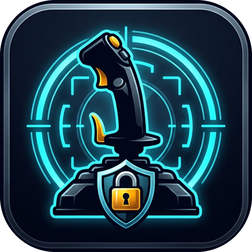

<p align="center">
  
</p>

# StickLock

[](https://github.com/zombiehausAI/StickLock/releases/latest)
[](https://github.com/zombiehausAI/StickLock/releases/latest)
[](https://microsoft.com)
[](https://dotnet.microsoft.com)
[](LICENSE)
[](https://ko-fi.com/zombiehaus)

**Universal Flight Controller Slot Synchronizer & Anti-Inversion Daemon for Space & Flight Sims**

StickLock is a zero-XAML, high-performance Windows desktop utility built with **.NET 10**, **WinForms Blazor Hybrid** (`Microsoft.AspNetCore.Components.WebView.WindowsForms`), and **MudBlazor**.

Space and flight simulators (including **Star Citizen**, **Elite Dangerous**, and other simulators) rely on Windows DirectInput enumeration order (`js1`, `js2`, device GUIDs, or instance IDs) to map physical flight sticks, throttles, and pedals. When controllers are disconnected, USB hubs power-cycle, or Windows reboots, DirectInput frequently shifts or inverts device enumeration order, scrambling your in-game flight controls. 

StickLock runs quietly in the Windows System Tray, monitors USB hardware changes in real time, compares current DirectInput device indices against user-locked canonical slots, and automatically keeps your controller bindings aligned across your favorite games via an extensible plugin architecture.

---

> [!NOTE]
> **Project Context & Disclaimer**:
> - **Solo Developer Side Project**: StickLock is an independent side project created and maintained by a single developer. Due to full-time work and outside commitments, I'm unable to dedicate full-time hours to it—updates, bug fixes, and maintenance happen as personal time permits. Your patience and understanding are greatly appreciated!
> - **Proof of Concept**: This application, setup scripts, utilities, and technical documentation represent an early **proof of concept** created to overcome Windows DirectInput enumeration order quirks and flight controller device mapping hurdles. While these setups have been tested across local Windows environments (Windows 10/11) and dual-stick / HOSAS / HOTAS hardware configurations, USB topologies, controller firmware, and driver versions can differ significantly. Community feedback, issue reports, and real-world testing are warmly welcomed!
> - **AI-Assisted Development**: This application and documentation were created with AI assistance. In the spirit of complete transparency: if you prefer not to use AI-assisted code, please feel free to pass on this project.

---

## Key Features

### 🔌 Multi-Game Plugin Architecture & SDK
- **Game-Agnostic Core**: DirectInput device discovery, canonical slot locking, USB hotplug monitoring, and configuration storage operate independently of any specific game title.
- **Out-of-Tree Plugin SDK (`StickLock.SDK`)**: Anyone can write, build, and publish custom game integration plugins without access to the StickLock source code. Community developers only need to implement the `IGamePlugin` interface and reference the lightweight SDK.
- **Dynamic Assembly Loading**: Automatically discovers, loads, and initializes plugins from `%USERPROFILE%\.sticklock\plugins\` in collectible, isolated assembly load contexts.
- **In-App Plugin Management**: Switch active games dynamically, reload plugins without restarting the application, and browse the plugins directory with a single click.
- **Extensive Plugin Guide**: Full architectural specifications, tutorials, and game case studies are available in [docs/PLUGIN_AUTHORING_GUIDE.md](docs/PLUGIN_AUTHORING_GUIDE.md).

### 🎮 Native Game Integrations
- **Star Citizen**:
  - Automatically detects root install folders and multiple channel environments (`LIVE`, `PTU`, `EPTU`, `TECH-PREVIEW`).
  - Reads and synchronizes `actionmaps.xml` across single or all detected environments simultaneously.
  - Automatically identifies Right Stick (Flight Stick) vs Left Stick (Strafe Stick) and configures primary flight axis profiles (**Space Sim** vs **Atmospheric**).
  - Dynamically calculates in-game console resort commands (e.g. `pp_resortdevices joystick 1 4`) with 1-click clipboard copy for live in-game resorting.
  - Auto-deploys synchronized profiles into `USER\Client\0\Controls\Mappings\layout_StickLock_Active.xml` for zero-restart reloading via in-game Control Profiles.
- **Elite Dangerous**:
  - Auto-detects bindings directories at `%LOCALAPPDATA%\Frontier Developments\Elite Dangerous\Options\Bindings\`.
  - Scans active `.binds` files (e.g. `Custom.4.2.binds`), analyzes bound DirectInput device names and GUIDs, and aligns controller indices to eliminate device order swapping.

### 🕹️ Universal DirectInput Slot Locking & USB Monitoring
- **Canonical Hardware Slot Locks**: Lock each physical stick to a fixed slot (`Slot 1 = Right VKB Gladiator`, `Slot 2 = Left VKB Gladiator`, etc.).
- **Real-Time WMI USB Monitoring**: Listens for `Win32_DeviceChangeEvent` notifications with a 1.5-second debounce window to absorb USB hub power-cycles and re-enumeration bursts.
- **Automatic Misalignment Detection**: Compares current Windows DirectInput enumeration against canonical slots and displays prominent avionics alert banners and tray notifications when swaps are detected.
- **Idempotent Multi-Pass Alignment**: Swaps and realigns controller references using intermediary placeholders to prevent keybind collision and corruption.

### 🔄 Built-In Auto-Updater & Channel Track Selector
- **Three-Tier Release Tracks**: Select your preferred update channel directly in the app:
  - **Release (Stable)**: Production-ready releases from the `main` branch.
  - **Beta (Development)**: Pre-releases from the `dev` branch for integration testing.
  - **Alpha (Feature Previews)**: Early-access builds from feature branches (e.g. `feature/plugin-system`).
- **In-Place Automated Updates**: Downloads installers with live progress indicators and applies updates seamlessly.

### 🛡️ Immune Storage & Process Protection
- **Immune User Storage (`~/.sticklock`)**: All configurations, custom profiles, and backups reside in `%USERPROFILE%\.sticklock\`, completely outside game folders to ensure immunity from game updates or folder wipes.
- **Process Guard**: Detects active game processes and safely defers background disk writes by default to prevent clobbering, with an optional "Force Sync" setting for advanced users.
- **Automated Rolling Backups**: Timestamped backups with configurable retention pruning and one-click restoration.

---

## Build, Test & Package Pipeline

StickLock includes an automated pipeline script for development, continuous integration, and packaging:

```powershell
# Full release cycle: Clean -> Unit Tests -> Self-Contained Publish -> ZIP, Windows Setup Installer (EXE), & SHA256 Checksums
.\Build-And-Package.ps1

# Build, package, and immediately install locally for testing
.\Build-And-Package.ps1 -Install

# Build, package, and install to a specific custom folder or drive
.\Build-And-Package.ps1 -Install -InstallPath "D:\StickLock"

# Skip automated tests during rapid iteration
.\Build-And-Package.ps1 -SkipTests
```

### Branching & Release Pipeline (Alpha -> Beta -> Release)

StickLock follows a strict three-tier progression model:

```
[ feature/* ] ────────► [ dev ] ────────► [ main ]
   (Alpha)                (Beta)             (Release)
v1.1.0-alpha.X         v1.1.0-beta.X          v1.1.0
```

- **Feature Branches (`feature/*` - Alpha)**: Work-in-progress implementations compiled automatically into **Alpha** pre-releases.
- **Development Branch (`dev` - Beta)**: Consolidated features undergoing integration testing compiled automatically into **Beta** pre-releases.
- **Main Branch (`main` - Release)**: Validated production software published as official stable releases.
- **Automated Version Tracking**: Managed via `.githooks/pre-commit` and `scripts/increment-dev-version.ps1` (`git config core.hooksPath .githooks`).
- **GitHub Actions CI/CD**:
  - `.github/workflows/release.yml`: Runs tests, builds self-contained `win-x64` binaries, compiles Inno Setup installers, and publishes stable GitHub Releases on pushes to `main`.
  - `.github/workflows/dev-build.yml`: Builds Alpha and Beta pre-releases and attaches installers on pushes to `feature/*` and `dev`.

### Build Artifacts Output
Artifacts are generated in the `artifacts/` folder:
- `StickLock-v<version>-win-x64.zip` — Standalone portable archive.
- `StickLock-v<version>-Setup.exe` — Windows Setup installer executable.
- `checksums.sha256` — SHA256 integrity manifest.

---

## Installer Usage (`installer\Install-StickLock.ps1`)

The installer script can be executed standalone from the repository or from inside an extracted distribution package:

```powershell
# Interactive installation (auto-detects existing installs or prompts for target directory)
.\installer\Install-StickLock.ps1

# Non-interactive / unattended update or install
.\installer\Install-StickLock.ps1 -Unattended

# Install to a custom directory or drive
.\installer\Install-StickLock.ps1 -InstallPath "E:\Games\StickLock"
```

---

## Development Transparency

This project and its accompanying utilities were developed with AI assistance (*Assisted by AI*). We believe in open transparency: if you prefer not to use or engage with AI-assisted software, please be aware before installing, evaluating, or running this application.

## Support & Contributions

If you find StickLock helpful for your flight controller setup, consider supporting ongoing development:

[](https://ko-fi.com/zombiehaus)

## License

This project is licensed under the [MIT License](LICENSE).
